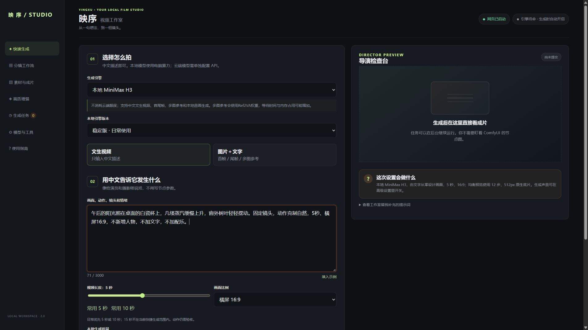
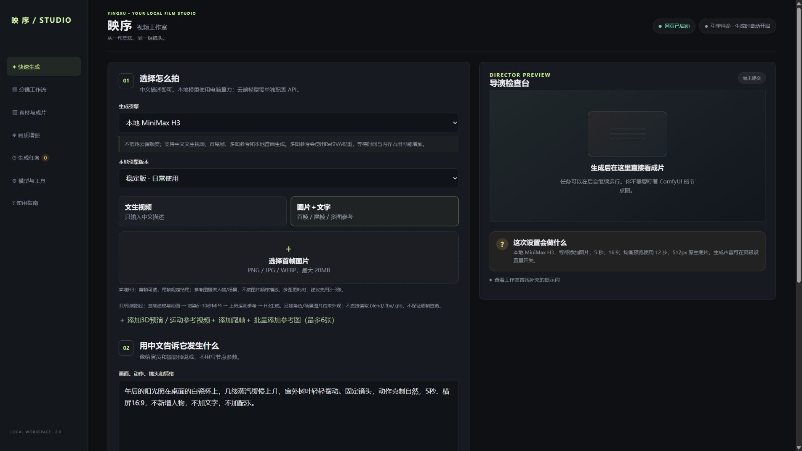
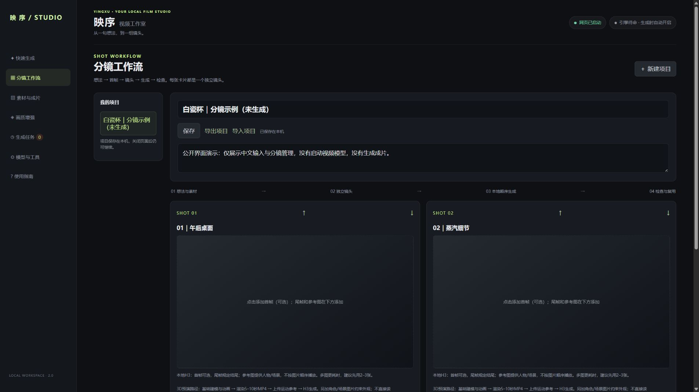
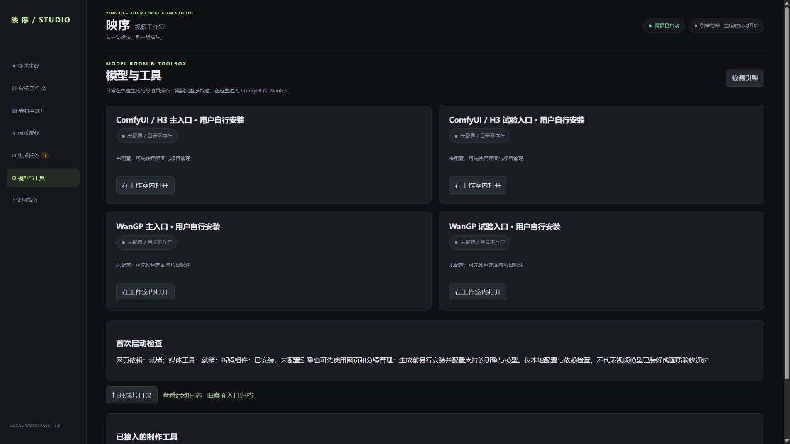

# 映序 · 本地视频工作室

**把复杂的本地 AI 视频操作，整理成中文生成界面和分镜工作流。**

[下载源码预览](https://github.com/hsjsbajnzj-dotcom/yingxu-video-studio/releases) · [快速上手](docs/QUICKSTART.md) · [首批试用](docs/TRY_IT.md) · [反馈问题](https://github.com/hsjsbajnzj-dotcom/yingxu-video-studio/issues/new/choose)

[先看40秒界面导览](https://github.com/hsjsbajnzj-dotcom/yingxu-video-studio/releases/tag/v0.1.0-rc.1)：预发布附件中的1920×1080静音截图剪辑，非连续录屏，未运行模型或生成成片。


> 0.1.0-rc.1 实验性源码预览。不是稳定版，也不是附带模型的一键安装包。
> 自有代码选择 GPL-3.0-only，署名“映序”；代码来源与第三方条款仍待最终核查。本目录没有附带视频引擎、模型、私有素材或个人配置。

映序为本地视频生成提供中文快速表单、分镜项目、素材查看与部分后处理适配。
它不是自研视频模型，也不保证达到商业云端模型的质量。

Yingxu is an experimental Chinese-language interface and shot workflow for independently installed local video engines. Models and engines are not included.



*来自公开版本的真实界面，使用隔离空白环境拍摄。示例提示词已输入，任务尚未提交；不是生成效果或速度证明。*

## 谁适合先试

- 已安装本地视频引擎，希望把日常中文输入、参考素材和分镜管理放在一起的创作者。
- 想参与测试安装与使用体验、愿意反馈问题的 ComfyUI / WanGP 用户。
- 暂未装模型也能查看界面和整理分镜，但不能因此生成视频。新手建议先读[快速上手](docs/QUICKSTART.md)。

## 看得到的操作，不夸大成片能力

| 页面 | 在这里做什么 | 需要另外准备什么 |
| --- | --- | --- |
| 快速生成 | 输入中文，选择模式、时长、比例和质量预设 | 生成前配置对应引擎、节点和权重 |
| 图片＋文字 | 首帧、尾帧、多图或预演参考请求管理 | 模型和节点支持；运动参考为实验性 |
| 分镜工作流 | 镜头卡片、项目保存与导入导出、顺序提交 | 实际生成仍取决于引擎；不是剪辑时间线 |
| 模型与工具 | 检查配置，识别缺失依赖与不可用入口 | FFmpeg及外部引擎自行安装 |

<details>
<summary>展开：参考素材、分镜和首次检查截图</summary>







这些截图没有使用私人素材，没有启动模型，也没有生成成片。拍摄所用本机媒体工具已安装，不代表下载本项目会附带这些工具。截图来源与版本见[素材记录](docs/MEDIA_PROVENANCE.md)。

</details>

仅在同一台Windows电脑的隔离环境验证，最新54项本地自动测试通过；不是新电脑或GPU画质验收。H3/WanGP等集成的具体发布义务及逐文件来源审查尚未完成，不能据此宣称全球无限制商用。维护者选择先公开源码供审查，不代表待核查项已经关闭。

## 现有功能范围

- 中文文字/图片请求、质量参数、后台任务及本地队列。
- 本地H3首帧、尾帧、最多6张参考图及参考用途；分镜保存与导出。
- ComfyUI与WanGP启动入口；外部引擎仍需用户独立配置。
- FFmpeg媒体工具；可选环境声、超分适配。
- 云端接口属于单独付费服务，不等同于消费端App免费额度。

## 当前不能承诺

候选版已统一目录配置，并提供独立网页环境安装器、首次诊断和启动入口。高级增强器默认关闭，须另行配置，不随网页安装自动安装。尚未完成全新电脑或 GPU 生成验收。

原机历史生成与编译器测试不等同于这个候选版已在全新电脑通过安装和出片验收。
首尾帧、多图参考和声音效果仍取决于底层模型、硬件、素材及实际验收。

## 发布前阅读

- [发布门槛](NOT_READY_FOR_PUBLIC_RELEASE.md)
- [第三方边界](THIRD_PARTY_NOTICES.md)
- [安全边界](SECURITY.md)
- [贡献指南](CONTRIBUTING.md)
- [许可证](LICENSE)、[版权范围](COPYRIGHT.md)与[许可决定](LICENSE-DECISION.md)

只应在回环地址进行本地试验。此候选不提供公网、多用户或付费服务部署能力。

## 一起改进

首轮希望找到 **5 位真实试用者**，优先验证安装、中文表单和分镜保存。遇到问题请用[试用清单](docs/TRY_IT.md)反馈，勿上传密钥、私人素材和完整日志。愿意改代码请先看[贡献指南](CONTRIBUTING.md)；质量对比请说明引擎、模型、参数、耗时和后处理，不用启动成功代替画质验收。

## 面向开发者的检查

以下是无需模型的检查，不会验证视频效果，也不会启动视频引擎：

```text
python -m compileall -q simple_video_studio
python -m unittest discover -s simple_video_studio -p test_image_assets.py
python -m unittest discover -s simple_video_studio -p test_realism_controls.py
```

## 安装与配置（Windows x64 / Python 3.12）

```text
python install_web.py --media
python start_studio.py --doctor
python start_studio.py --no-browser --port 7869
```

访问 http://127.0.0.1:7869/ 。已有工作室运行时选择其他空闲端口。

安装器从官方 PyPI 安装二进制包到独立 `.venv`；不安装 Torch/CUDA、引擎或权重，不改系统 Python。省略 `--media` 仅安装网页依赖。重复安装保留已有 config.local.json。

FFmpeg/FFprobe 需自行安装到 PATH，或在本地配置的 tools 填写实际路径。本包不捆绑二进制。所有相对路径相对于配置文件目录解析，可用 YINGXU_CONFIG 指定配置。

在 engines 对应条目填写 root、python、port；Python 必须是该引擎自己的解释器。ComfyUI root 包含 main.py，base_directory 指向包含 custom_nodes 等资源的安装基目录；模型、输入输出路径应与实际布局匹配。WanGP 当前适配 root/app/wgp.py 结构。未配置时禁用入口，不自动安装模型。可选增强器需独立环境与节点，启用前检查兼容性和许可。本地配置不要上传。

2026-10-20：当前同机独立无Torch环境54项测试通过。早期迁移目录的安装与重复安装、41项测试、诊断和网页检查通过，但最新候选尚未重新做完整迁移验收。媒体测试复用了本机FFmpeg，不是全新电脑或GPU出片验收。原机工作室保持不动。

完整测试（需媒体依赖与 FFmpeg）：

```text
.venv\Scripts\python.exe -m unittest discover -s simple_video_studio -p test_*.py
```
